# Cross-working condition unsupervised domain fault diagnosis? MATLAB code implementation

I. Problem Background - Bearing Fault Diagnosis is a key link in the operation and maintenance of industrial equipment. Traditional intelligent diagnostic methods usually assume that the training data and test data come from the same working conditions.
In actual industrial settings, the speed and load of equipment constantly change. For example, a model trained on data collected at 1797 revolutions per minute may not perform well when used to diagnose signals at 1730 revolutions per minute, leading to a significant drop in accuracy. This is known as domain shift—the distribution of the source domain (training data) no longer aligns with that of the target domain (test data).
More challenging is that the target domain data often lacks labels. The device is in operation and cannot know the current fault status, but it still needs the model to make accurate judgments.
At this point, unsupervised domain methods are needed to solve this problem!
In recent years, the field of unsupervised domain methods has seen relatively easier publication opportunities. This approach differs from traditional machine learning, deep learning, and data-driven diagnostics, with a slightly higher threshold for entry. However, once mastered, it allows for more substantial content to be written about, avoiding the commonality that can lead to mediocrity.
II. What was accomplished in this tweet regarding the above issues, this project, based on the unsupervised domain adaptation concept, has implemented three mainstream cross-conditional fault diagnosis methods (DAN, DANN, CDAN), and conducted 18 transfer tasks experiments on two public bearing datasets (West China University of Science and Technology data, Jiangnan University data) through MATLAB code.
III. Data Set Introduction - Case Western Reserve University Bearing Dataset (CWRU) The CWRU dataset is one of the most classic benchmark datasets in the field of fault diagnosis, originating from the bearing fault experimentation lab at Case Western Reserve University in the United States.
Sampling frequency: 12kHz
JNU bearing dataset (JNU) originates from the Mechanical Engineering Laboratory of Jiangnan University, with collection conditions closer to actual industrial scenarios.
Sampling frequency: 50kHz
IV. Transfer task design: pairing two different speeds to form a transfer task (the design of this transfer task can be referred to the reference: "Lv Zhongwei. Research on Failure Diagnosis Method Based on Transfer Learning for Rolling Bears [D]. Shanxi University, 2025.").
CWRU (12 tasks): All directed pairs between all 4 speeds (e.g., 1797 → 1772, 1772 → 1797, 1797 → 1750... until 1730 → 1750)
\n        \n  
JNU (6 tasks): All directed pairs between 3 speeds (e.g., 600 → 800, 800 → 600, 600 → 1000... until 1000 → 800)
\n        \n  
In each task, source domain data is labeled for training, while target domain data is unlabeled only for testing and evaluation. The training set and test set are divided in a ratio of 7:3, ensuring equilibrium across all categories.
V. Data Processing Flow: Raw Signal → Segmentation → Continuous Wavelet Transform (CWT) → 64×64×3 RGB Time-Frequency Image
The original one-dimensional vibration signal is converted into a two-dimensional time-frequency image through continuous wavelet transform using the CMORT3-3 complex Morlet wavelet. The time-frequency image retains both temporal information and frequency characteristics, containing richer fault representations than the original waveform and is very suitable for convolutional neural network processing.

VI. Three Domain Adaptation Methods DAN (Deep Adaptation Network)

Core idea: Add constraints in the deep network to ensure that the source domain features extracted are statistically close to the target domain features. The distribution difference between the two domains is measured using the maximum mean discrepancy (MMD) metric, and this gap is minimized during training.
DANN (Domain Adversarial Neural Network)

Core idea: Drawing inspiration from the concept of generative adversarial networks. A "domain discriminator" is added to the network to distinguish between features coming from the source and target domains; the feature extractor then "deceives" the domain discriminator. Through this adversarial process, the feature extractor learns to represent features invariant to the domain.
CDAN (Conditional Domain Adversarial Network)

Core idea: An improved version of DANN. In addition to feature information, the classification prediction results are also used as conditional information in the domain discrimination process, allowing domain alignment to be conducted under consideration of class structure, thereby avoiding coarse-grained global alignment.

VII. Results Display: This project is implemented based on MATLAB, supported by GPU acceleration. The experimental results are as follows:
CWRU dataset (10 classes of faults, 12 transfer tasks)
JNU dataset (4 classes of faults, 6 transfer tasks)
Overall average accuracy of each method

VIII. Visualization Results:

      \n      \n      \n      \n      \n      \n      \n      \n      \n
Each task includes confusion matrix plots, t-SNE dimensionality reduction plots, and loss function curve plots, which are not elaborated upon here. 9. Method comparison summary: Unsupervised domain adaptation provides a practical path for cross-condition fault diagnosis: without any labeled data from the target condition, diagnostic models that are effective for the target condition can be trained by only utilizing labeled data from the source condition and unlabeled data from the target condition.
Domain adaptation method has significant effects: The accuracy of three methods exceeds 90% in most cross-condition tasks, indicating that unsupervised domain adaptation can effectively cope with the distribution shift caused by condition changes.
CDAN performs optimally: The conditional domain adversarial network aligns classification prediction information as alignment conditions, achieving the highest accuracy in most tasks, indicating that fine-grained alignment considering class structure is superior to global alignment.
DAN stability is good: The principle of the DAN method based on MMD is simple, and it performs stably in all tasks, without any obvious failure cases.
DANN occasionally experiences fluctuations: The instability of adversarial training is evident in some challenging tasks, such as those with significant differences in speed.
X. Code Directory
The ReadMe file contains detailed information about each script's functionality and how to use it. There is no need to worry about running the code.
\n\nNote: This code requires MATLAB version 2023 or above to run!

## Images

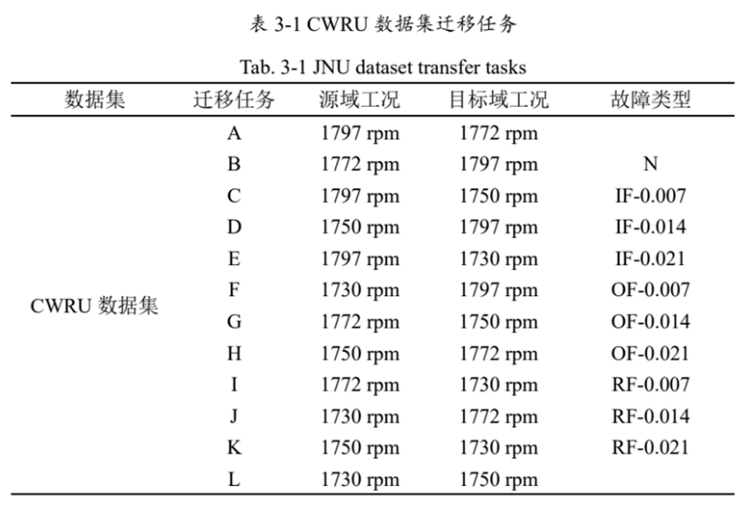
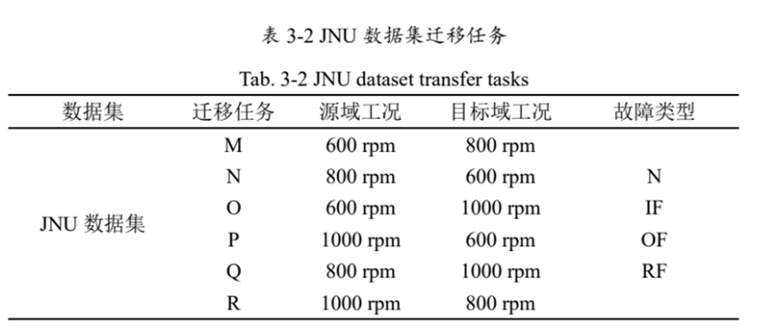
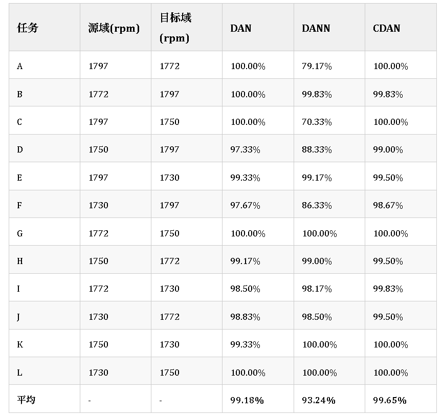
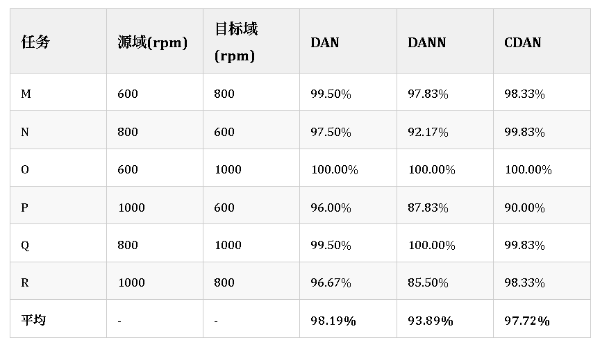
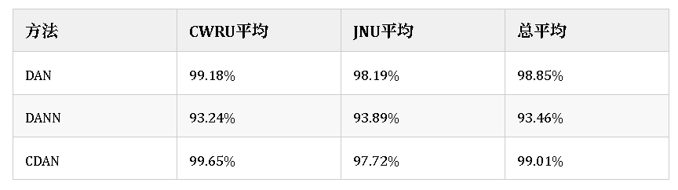
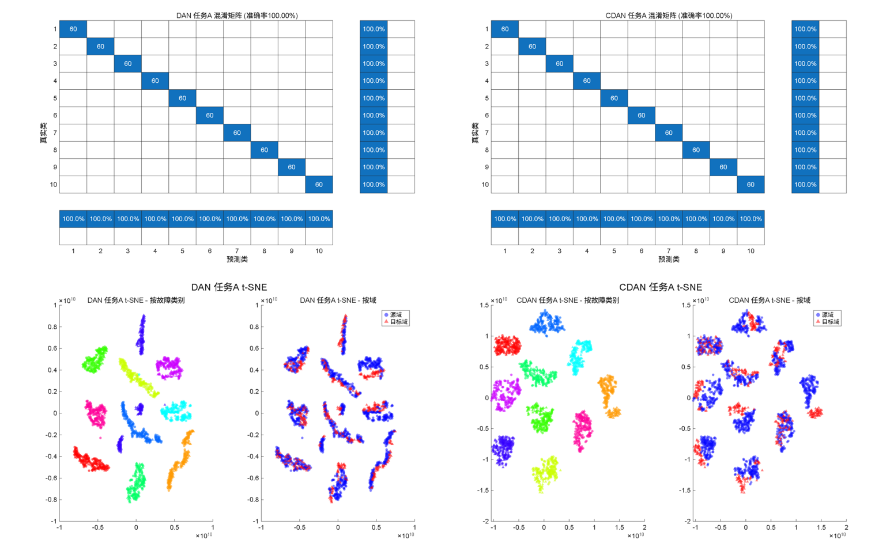
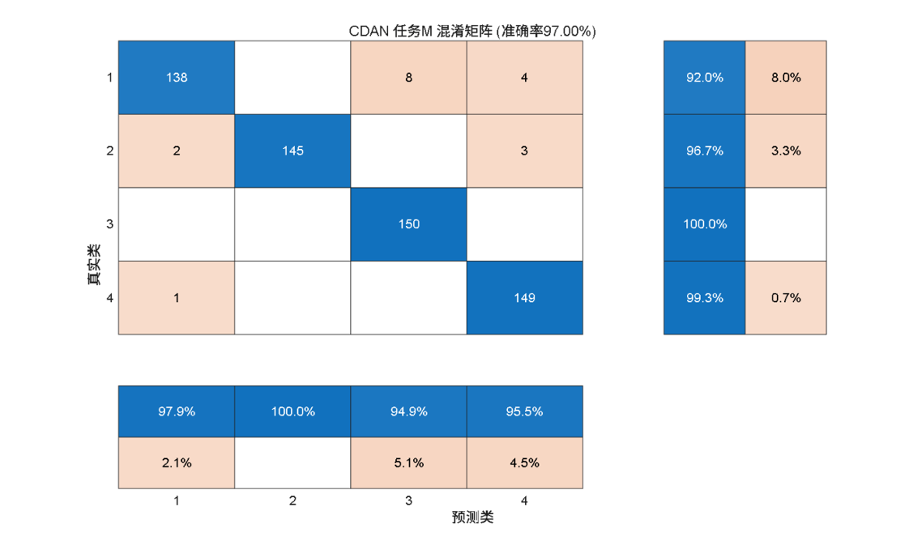
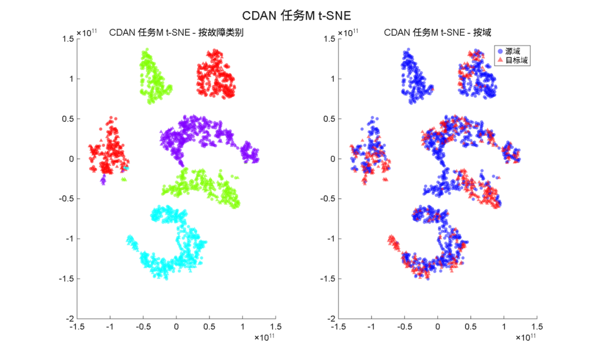
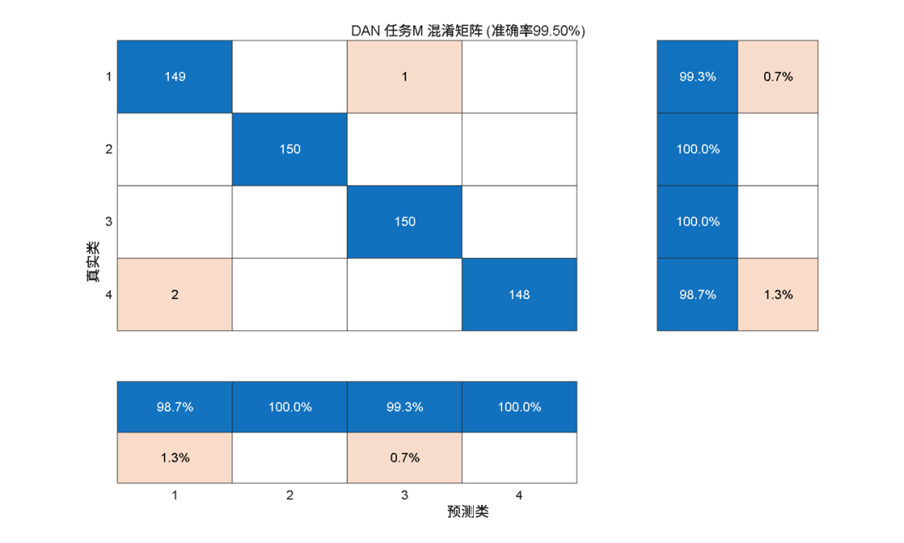
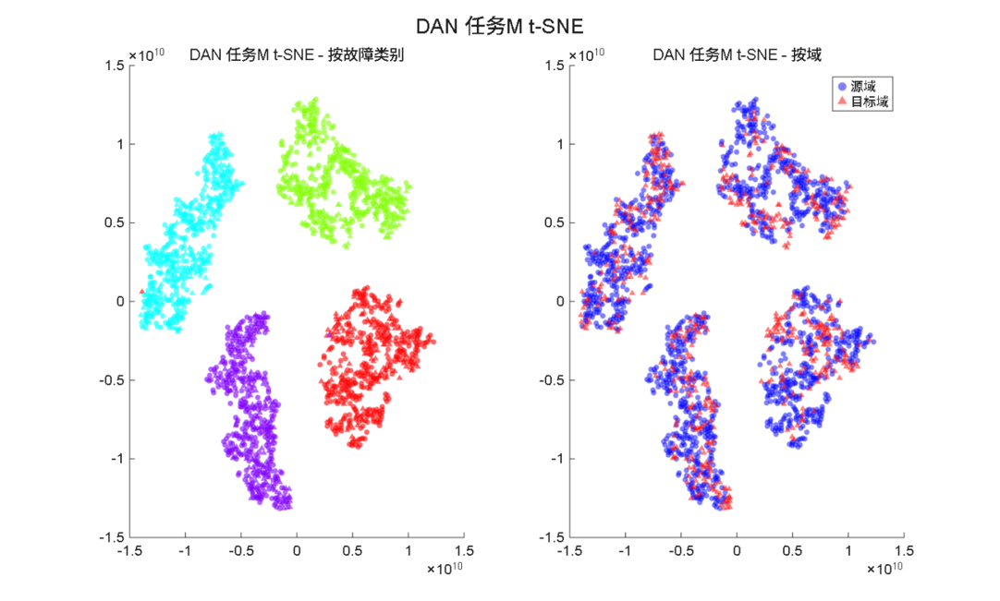
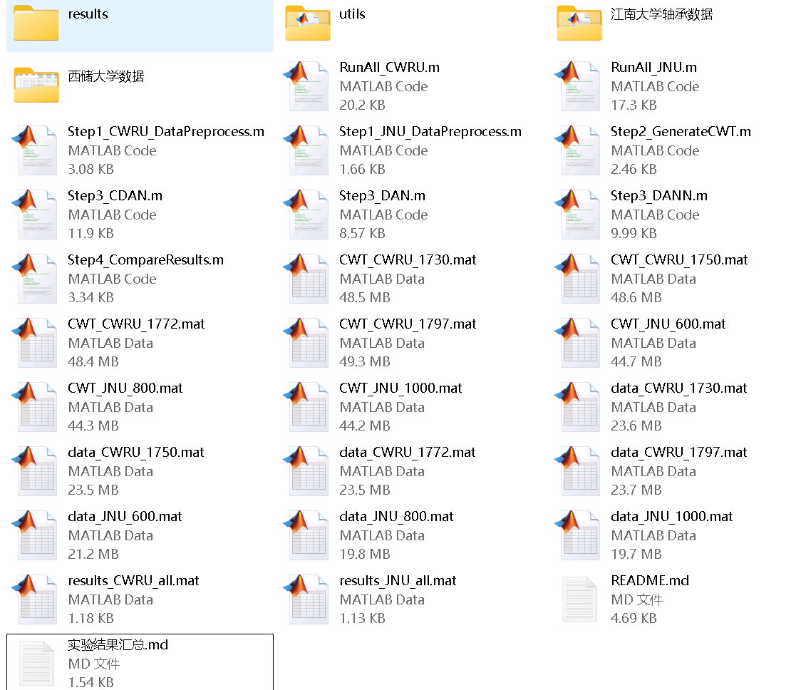
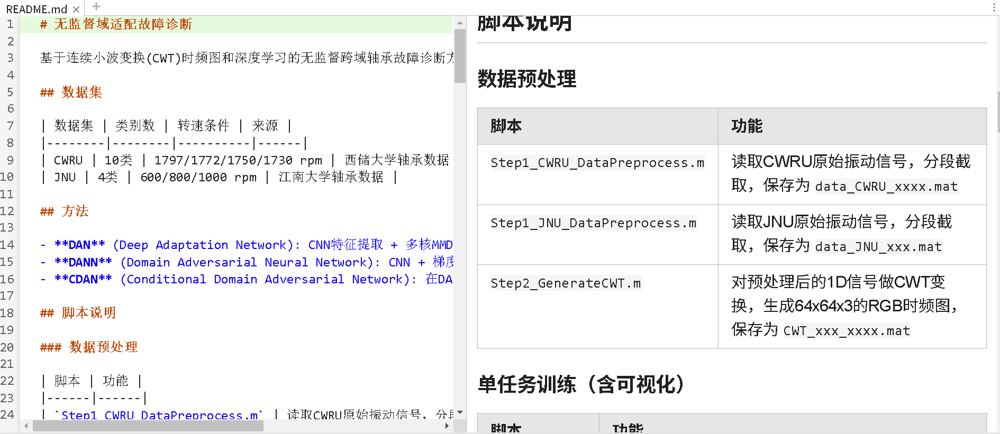

<!-- PAYMENT_BLOCK -->

## Get this dataset

- Payment link (Stripe): [Buy now](https://buy.stripe.com/3cs8yP7sY87d0vu9AB)
- Payment QR code: 

<!-- /PAYMENT_BLOCK -->
